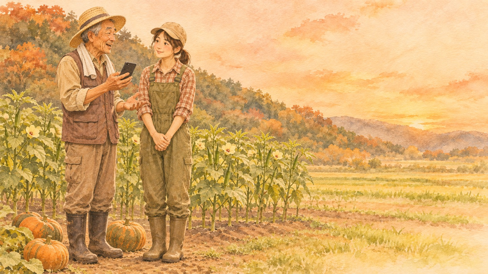

#  つぎて帳（Tsugite-cho）


<sub>絵とアイコンは AI（画像生成）で作った架空の場面・図案です。実在の人・場所ではありません。</sub>

> Built with Claude: Japan 2026 応募作品 ／ テーマ1「あなたにしかない深さ」
> **アプリの中の人名・地名・数字はすべて架空です。**（下の「どれだけの課題か」の数字だけは国の公表資料）

農家さんが**話すだけ**で、段取りと判断のコツが、**継ぐ人と地域の新人のノート**になる。
質問は、ノートにあれば**話した人の言葉**で、近い人から順に答える。無ければ**答えを作らず、いちばん近い農家さん1人に聞く**。
ノートの1行ごとに「**誰が・いつ話したか**」と、**元の言葉**にたどれる。**だれに見せるかは、話した本人が決める**。

主役は**継ぐ人**：家を継ぐ家族と、町に来て新しく農業を始めた人（研修生など）。農家さん本人は、大きなボタンを押して話すだけ。町の担当者は、**数だけ**を見る。

---

## どれだけの課題か（国の公表資料）

| | 数 | 出どころ |
|---|---|---|
| 農業を主な仕事にしている人（基幹的農業従事者） | **103万6千人**。5年前より **24.0%減**。**65歳以上が69.6%**、平均年齢67.7歳 | 農林水産省「[2025年農林業センサス 結果の概要（確定値・令和7年2月1日現在）](https://www.e-stat.go.jp/stat-search/files/data?sinfid=000040483733&ext=pdf)」 |
| 経営主が65歳以上の農業経営体のうち、後継者を確保していない | **58.8%** | 農林水産省経営局「[農業経営をめぐる情勢について](https://www.maff.go.jp/j/kobetu_ninaite/261002_meguzi.pdf)」（令和8年10月・2025年農林業センサスより）p.36 |
| 地域計画の区域で、将来の受け手が決まっていない農地 | **134万ha（約3割）** | 農林水産省「[地域計画の策定状況](https://www.maff.go.jp/j/keiei/koukai/attach/pdf/chiiki_keikaku-165.pdf)」（令和7年4月末時点） |
| 新規就農者のうち49歳以下 | **14,410人**（前年より8.3%減） | 農林水産省「[令和7年 新規就農者調査](https://www.maff.go.jp/j/tokei/kouhyou/sinki/pdf/sinki_syunou_25.pdf)」 |

継ぐ人が見つかっても、**段取りと判断のコツは本人の頭の中にしかない**。しかも、それが伝わるのは家の中だけ。町に来た新人は、誰に何を聞けばいいかも分からない。本人が倒れたら、全部消える。

## 3つの課題と、どう解くか

| 課題 | つぎて帳の解き方 |
|---|---|
| **手を煩わせず、すぐ答えを得る** | 本人は話すだけ。新人は一言聞くだけ。町は何も入力しなくても数が見える。**一度答えたことは、二度聞かれない**（本人の手間も減る） |
| **閉じた世界を開く** | いまは家の中でしか伝わらない言葉を、**本人が許した話だけ**、地域の新人にも届ける。誰のノートにも無ければ、その作物を作っている近くの農家さん**1人だけ**に質問が届く（質問が家の外へ流れる） |
| **地域の生産を残す** | ①離農しても技術の記録が残り、受け手の決まっていない農地を次の人が作りやすくなる ②新人が早く一人立ちして、地域に残りやすくなる ③町の支援が、問い合わせへの対応から「聞ける人がいない作物」など効くところへ回る。裏づけの数字は下の表（金額の見込みは自分で計算しない） |

### 「地域の生産を残す」の裏づけ（公表資料）

| | 数 | 出どころ |
|---|---|---|
| 農業が生み出す付加価値（農業総生産・GDP に入る額） | **4兆9,705億円**、GDP の **0.8%**（令和6年） | 農林水産省「[農林水産業ひと口メモ 1 農林水産関係主要指標](https://www.maff.go.jp/j/kanbo/hitokuchi_memo/attach/pdf/index-138.pdf)」p.3（内閣府「国民経済計算」より） |
| 基幹的農業従事者の見込み | 今後20年で **約4分の1**（116万人→30万人）に減る見込み | 農林水産省「[スマート農業技術活用促進法 参考資料（詳細）](https://www.maff.go.jp/j/kanbo/kihyo03/gityo/kihon_sisin/attach/pdf/sisin1-3-1-2.pdf)」（令和6年6月）。推計の方法は資料に書かれていない |
| 「10年後も耕す人」が決まっている農地のうち、一定年齢以上の農業者の農地 | **約56万ha**（13.2%）。将来使われないリスクのある農地として示されている（一定年齢は「75歳程度までで設定されている地区が多い」） | 農林水産省「[地域計画の分析・検証について](https://www.maff.go.jp/j/keiei/koukai/attach/pdf/chiiki_keikaku-189.pdf)」（令和7年12月・令和7年4月末のデータ） |
| 就農時に「営農技術の習得」に苦労した新規参入者 | **56.0%**（3つまで選ぶ。「農地の確保」72.7%、「資金の確保」70.7%に次ぐ） | 全国農業会議所・全国新規就農相談センター「[新規就農者の就農実態に関する調査結果－令和６年度－](https://www.be-farmer.jp/uploads/statistics/r6_zittai.pdf)」（2025年3月）p.23。農林水産省「[新規就農者の育成・確保について](https://www.maff.go.jp/j/new_farmer/pdf/shinkishuno.pdf)」でも引用 |
| 経営面の課題に「技術の未熟さ」を挙げる新規参入者 | 就農1・2年目 **40.1%** → 3・4年目 31.7% → 5年目以上 26.1% | 同調査 p.50 表36 |
| 農業所得で生計が成り立っている新規参入者 | 就農1・2年目 **23.1%** → 3・4年目 39.3% → 5年目以上 51.5% | 同調査 p.42 図9 |

- 新規就農の調査は、就農後おおむね10年以内の人が対象で、資金の受給者が中心（回収率は約20%）。新規就農者全体を代表する数字ではありません
- 「技術の未熟さ」と「生計」はどちらも就農年数ごとの割合で、技術が身につけば生計が成り立つ、という因果を示す数字ではありません。並べて見せているだけです
- 金額・面積・人数を掛け合わせて「○兆円が失われる」といった見込みは作っていません

つぎて帳がねらうのは、この「一人立ちまでの数年」を、地域の農家さんの言葉で短くすることと、高齢の農家さんが耕している農地の段取りを、次の人が受け取れる形で残すことです。

### 「最適な答え」をどう決めるか

AI が「いちばんよいやり方」を判断することは**しません**（それは農業の助言で、間違えたときの害が大きい）。
その代わり、**その場所・その作物で、いちばん近い人の言葉**をすぐ出します。並べる順番は「家族 → 研修先 → その作物を作っている → 同じ地区 → 農業の年数」。理由も画面に出します。

### どれだけの課題を解けるか

| 課題 | 度合い | 理由 |
|---|---|---|
| 段取り・判断のコツが本人の頭の中にしかない | ◎ | 話すだけで、本人の言葉のまま・いつの話か付きでノートに残る |
| 継ぐ人・新人が聞きにくい／誰に聞けばいいか分からない | ◎ | ノートに無ければ、いちばん近い本人1人に届き、次の「話す」で聞かれる。答えはノートに入り、二度聞かなくてよい |
| 家の中の知恵が、地域の新人に届かない | ○ | 本人が「地域の新人にも」とした話だけ届く。最初は「家族だけ」 |
| 町が、新規就農の支援でどこが足りないか分からない | ○ | 作物・地区ごとの数と「聞ける人がいない質問」が見える。人の評価はしない |
| 本人が文字を打てない・操作を覚えられない | ○ | 押して話すだけ・ログインなし（専用リンクを QR カードで配る） |
| 継ぐ相手がいない（後継者不在）・人を選ぶこと | 対象外 | 人を探す・選ぶ・評価することはしない |
| 栽培のやり方の正しさ・農業の助言 | 対象外 | AI は助言しない。ノートは本人の判断の記録で、正しさは保証しない |
| 農地・資金・相続の手続き | 対象外 | 別の制度と窓口の仕事 |

## 誰の・どんな課題か

- **新しく農業を始めた人**（主役。研修生・移住者）：「いつ・何を・なぜ」が分からない。誰に聞けばいいか分からない。聞くたびに相手の手を止めてしまう
- **家を継ぐ人**（家族）：本人に聞きにくい、聞くタイミングがない。本人が倒れたら全部消える不安
- **農家さん本人**（70〜80代）：段取りや判断のコツが自分の頭の中にしかない。文字を打つのは苦手。同じことを何度も聞かれる
- **町の担当者**：新規就農の相談に来た人に、地域の誰の知恵をつなげばいいか分からない。足りない分野が見えない

作者は、流通・補助金・現場支援で生産者に並走してきました。そこで繰り返し見たのは「段取りが次の人に渡らないまま、担い手がいなくなる」ことです。

## どう解決するか（画面）

| 画面 | だれが | できること |
|---|---|---|
| 話す | 本人 | 大きなボタンを押して話すだけ。返事は読み上げ。自分あての質問があれば、ここで**1つずつ**聞かれる。話したあと「この話を、だれに見せますか？」（家族だけ／地域の新人にも／町にも）を大きなボタンで選ぶ |
| 次の作業 | 本人 | 話から作業カード（いつ・何を・誰が）。「済み」を押すだけ |
| 話したこと | 本人 | 自分の話と、それぞれを誰に見せているか。あとから変えられる |
| 引き継ぎノート | 継ぐ人・新人 | 見てよい話だけを、作物×時期ごとに。1行ごとに「誰が・いつ」と元の話（その文に印）にたどれる。家族・研修先の話が先に並ぶ |
| 質問する | 継ぐ人・新人 | ノートにあれば、話した人の言葉で、近い人から順に（理由つき）。無ければ「○○さんに聞きます（選んだわけ：研修先・同じ地区…）」。作っている人がいなければ「聞ける人がいない」と出し、町に数だけ知らせる |
| 地域の引き継ぎ帳 | 町の担当者 | 作物・地区ごとの数、ノートで答えが出た質問、本人に聞いている質問、聞ける人がいない質問。言葉は本人が「町にも」とした話だけ。質問した人の名前は出ない |

## 使い方（新人の目線・3分）

1. 青木さん（架空・29歳・川端さんのところで研修中）の画面で「引き継ぎノート」を開く。南川町（架空）の農家さん3人が「地域の新人にも」と見せてくれた言葉が、作物ごとに並んでいる。「元の話を見る」で、その日に話した全文にたどれる。家族だけの話（体の具合など）は出てこない
2. 「質問する」で「かぼちゃはいつとればいいですか？」→ **山野さん（同じ川口地区・農業50年）と大西さん（上原地区・農業60年）の2人の言葉**が、近い順に出る。「上原は冷えるのが早いけん、川口より一週間は早よとる」のように、場所で違うことも本人の言葉で分かる
3. 「石灰はどのくらいの量をまけばいいですか？」→ ノートに無いので答えを作らない。「近い話（抜いたら石灰ふって）はあるが、量はまだだれも話していません。川端さんに聞きます（研修先・同じ川口地区）」
4. 川端さん（架空・66歳）の画面に「研修生の青木さんが聞きたいこと」が出る。押して話すだけで答える（デモでは「見本の話を入れる」）。「青木さんに届けました」→「この話を、だれに見せますか？」で「地域の新人にも」を選ぶ
5. 青木さんの画面に答えが届く。もう一度聞くと、今度はノートから答えが出る（二度聞かない）
6. 「にんにくはいつ植えれば…」→ 町に作っている人がいないので「聞ける人がいない」。町の担当者の画面で、作物ごとの表に色つきで出る（最初の状態にも、前から聞いてあった1件として入れてある）
7. もう一度「引き継ぎノート」を開くと、朝 29 行だったノートが 31 行（今日 +2）。石灰の量（川端さんの言葉）が「畑全体」に入っている

パソコンでは入口の「3つを並べて見る」で、青木さん・川端さん・町の画面を横に並べて流れを追えます。家を継ぐ健太さん（架空）の画面もあります。

動画を撮るときの台本（時間・画面・操作・語り・字幕）は [docs/demo-script.md](docs/demo-script.md) にあります。

## このアプリがしないこと

- **答えを作らない**：ノートに無いことは答えない。答えるときも、話した人の言葉の行をそのまま出す（ほかの人の言葉と混ぜない。誰の言葉かを必ず付ける）
- **農業の助言をしない**：栽培のやり方・量・時期の正解を AI が言わない
- **本人の言葉を書き換えない**：方言も言い直しも、標準語に直さずに残す
- **人を探さない・選ばない・評価しない**
- **本人が許していない話を見せない**：最初は「家族だけ」。町にも、本人が「町にも」とした話の言葉しか見えない

### 基本的な RAG（文書を検索して答える仕組み）との違い

答えになる知識は、**まだどこにも書かれていません**。つぎて帳は、その知識を本人に聞いて**作る**ところが中心です。ノートに無ければ、いちばん近い本人に1つずつ聞き、答えがノートに入り、次からは誰も同じことを聞かなくてよくなります。検索して文章を作ることはしません。

## 高齢の本人が使える条件と、見せる範囲の守り

- 押して話すだけ（大きなボタン1つ）。打つ・覚える操作をさせない。見せる範囲だけは大きなボタン3つから選ぶ
- **ログインなし**：一人ひとりに推測できない「専用リンク」を作り、町や家族が QR カードにして渡す想定。ホーム画面に置けば、次からはそこから開くだけ
- **誰として動くかはサーバーが専用リンクの合言葉から決める**。画面の中で名乗ることはできず、自分の話・自分あての質問・自分の作業しか動かせない。見る人ごとに、見てよい話だけを返す
- 大きな字。返事は読み上げ。聞き返しは1回に1つだけ。「今はわからん」で後回しにできる
- 家族や研修生が横でスマホを持って聞き取ってもよい（それ自体が教わる時間になる）

## 試し方

Node.js 20 以上が必要です。使っている外部のライブラリは Anthropic 公式 SDK だけで、キーを入れたときだけ読み込みます。**API キーが無くても動きます**（下の「見本の整理」）。

```bash
git clone https://github.com/HiDax0407/tsugite-cho.git
cd tsugite-cho
npm run setup-hooks   # 秘密情報のコミットを止める仕組みを有効にする
npm start             # http://localhost:8793
```

- 入口 `/` に、デモ用に全員の専用リンクが並びます（青木さん・健太さん・農家さん3人・町の担当者・3つを並べて見る）
- 専用リンクの合言葉は初めて起動したときに作られ、`data/runtime/keys.json`（リポジトリに入れない）に残ります
- 入口の専用リンク一覧と「最初の状態に戻す」は、**手元で動かすときだけ**出ます。公開の名前（`PUBLIC_HOST`）を入れて公開すると出ません。架空データのデモとして公開するときだけ、`.env` に `DEMO_LINKS=1` と書きます
- スマホの幅で見ることを前提にしています。入口の「最初の状態に戻す」で架空データの最初に戻ります。「撮影用：最初の状態にして3つを並べる」は、戻してすぐ3つの画面を並べます（用意した架空の話は Claude を呼ばず決まった規則で整理するので、何度戻しても同じ状態になります）
- テスト：`npm test`
- 声の入力はブラウザの音声入力（Chrome・Safari）。使えない端末では「文字で入れる」

### 見本の整理（いま）と Claude（これから）

いまは Claude をつないでおらず、**決まった規則で話を文に切り、作業カードとノートの行にし、質問とノートを照らしています**（画面の右上に「整理：見本（Claude 未接続）」と出ます）。質問・話のたびに、右上に少しのあいだ「照合：見本（未接続）」「聞き返し：見本（未接続）」のように、その場で働いた役が出ます。Claude をつなぐと「照合：Claude Opus 5.5」「聞き返し：Claude Haiku 5.5」に替わり、Claude が失敗して規則に戻ったときは「見本」と出ます。規則は控えめに作ってあり、自信がないときは答えずに本人に聞きます。Claude をつなぐと、同じ流れのまま中身が Claude に替わります（下の「Claude の使い方」）。

## 期間中に作ったもの／事前に用意したもの

ハッカソンのルール（キックオフ前のコード・既存プロジェクトの再利用は不可）に従い、**コードはすべて 2026-11-02 12:30（開発開始）以降に新しく書いたもの**です。既存のアプリのコードは持ち込んでいません。

| 区分 | もの | 備考 |
|---|---|---|
| 事前に用意 | `data/prepared/tsugite_producer.json` | 2026-11-02 朝（キックオフ前）に作者が作った**架空の**テキストデータ（山野さんの聞き取り）。手を加えずに置いている |
| 事前に用意 | 設計メモ | リポジトリの外に置いている（構想・計画） |
| 期間中に作成 | 上記以外のすべて（コード・画面・`data/region_demo.json`〔架空の町・農家さん・研修生〕・`data/demo_answers.json`〔架空の見本の話〕・`public/img/`〔AI の画像生成で作った架空の場面の絵とアイコン〕・テスト・フック・`CLAUDE.md`） | 作業の記録は [DEVLOG.md](DEVLOG.md) とコミット履歴 |

使っているもの：Node.js 標準機能と Anthropic 公式 SDK（`@anthropic-ai/sdk`。キーを入れたときだけ使う）。

## 現場の方に見てもらって直したこと

試作を、現場の方（生産者・新しく農業を始めた人）に見てもらい、いただいたご意見で直したことを書きます。ご了承をいただいた範囲だけを書き、お名前は出しません。

| いただいたご意見（要約） | 直したこと | コミット |
|---|---|---|
| （ご意見をいただいたら書きます） | | |

## Claude の使い方

**アプリの中**：つなぎ口（`src/claude.mjs`・Anthropic 公式 SDK）はできています。ハッカソンのクレジットが届いたら、専用キーと使用上限を設定してからつなぎます。キーが無いあいだ・失敗したとき・上限に達したときは、同じ流れのまま「見本の整理」（決まった規則）で動きます。

| 役 | すること | モデル |
|---|---|---|
| まとめ役 | 話を文に切るのは手元の規則（本人の言葉そのまま）。Claude は文ごとに「どの作物か・様子かコツか・印・これからの作業か・期限の言葉」を付ける（決まった形の JSON） | `claude-opus-5-5` |
| 照合役 | 質問に、**見てよいノートの行の番号だけ**で答える。文は作らない。無ければ「まだ誰も話していないこと」を返す | `claude-opus-5-5` |
| 聞き手 | 話の抜けを1つだけ、短い質問で聞き返す。いちばん先に聞くのは「ええ頃」「様子を見て」のようなあいまいな判断の「どこを見て決めるか」、次に いつ・どのくらい・なぜ。聞き返しに答えた直後は、続けて聞かない。新人の質問を、高齢の本人に伝わる言い方に直す | `claude-haiku-5-5`（速い返事のため） |

**Claude の答えを信じきらない（プログラムで確かめる）**

- 画面に出る言葉は、必ず本人が話した文そのものから取る。Claude が返した作物・印・期限の言葉は、名簿や話の中に無ければ捨てる
- 照合役が返した番号のうち、その人が見てよい行の番号だけを使う。家族だけの話は、Claude にも送らない
- 聞き返しは「質問の形・短い・助言の言い回しを含まない」ものだけ。言い換えで中身（作物などの言葉）が変わったら、元の質問をそのまま伝える
- 断られた（`refusal`）・途中で切れた・形が違うときは、見本の規則で続ける。上位モデルは、断られたときにサーバー側で別のモデルが引き継ぐ設定（`fallbacks: "default"`）にしている
- 1日に呼ぶ回数の上限（`CLAUDE_MAX_CALLS_PER_DAY`、空なら200回）。超えたら見本の規則で動く
- これらはテスト（`tests/claude.test.mjs`）で、偽物の Claude を使って確かめている（本物の API は呼ばない）

**つなぐときの手順**：`npm install` → Claude Console でハッカソン専用のキーを作り、使用上限を設定 → `.env` に `ANTHROPIC_API_KEY=` を書く（`.env` はリポジトリに入らない）→ `npm start`。画面の右上が「整理：Claude」になります。

並べる順番（近い人から）と、質問を届ける相手を決めるのは、AI ではなく決まった規則です（理由を画面に出せるように）。

**開発**：Claude Code を中心に開発。この作品用のフック・GitHub Actions などをリポジトリ内に期間中に作り、[DEVLOG.md](DEVLOG.md) に日ごとに残しています。

- 秘密情報の守りは三段：Claude Code のフック（`.claude/hooks/guard-git.mjs`）→ git のフック（`.githooks/`）→ GitHub Actions（全履歴の再検査とテスト）

## ライセンス

MIT

---

## English summary

**Tsugite-cho** ("successor's notebook") turns the know-how that lives only in elderly farmers' heads into a notebook for the people who come next — family successors and newcomers to the town.

- **Farmers just talk**: one big button, no login (a personal link handed out as a QR card), large text, replies read aloud, one follow-up question at a time. Dialect is kept exactly as spoken. **The farmer decides who may see each talk** (family only / newcomers in the area / the town office). Default: family only.
- **Successors and newcomers read a notebook** of what they are allowed to see, by crop and season. Every line shows who said it, when, and links back to the original words.
- **They ask questions**: if the notebook has it, the answer is the farmers' own words, closest person first (family → mentor → grows that crop → same district → years farming), with the reason shown. The AI never writes an answer. If not, the question goes to **one** nearest farmer, who is asked it the next time they talk; the answer flows back and no one has to ask it again.
- **The town office sees numbers only**: notes by crop and district, questions answered from the notebook, questions with no one to ask. No names of askers, no evaluation of people.
- No farming advice. Identity is decided on the server from the personal link, not from anything the page sends.

Context (Japan, official data): 1.036 million core farm workers, down 24.0% in five years, 69.6% aged 65+ (2025 Census), expected to fall to about a quarter (1.16M → 0.30M) in 20 years (MAFF); agriculture's value added is ¥4.97 trillion, 0.8% of GDP (2024); 58.8% of farms with a manager aged 65+ have no successor secured; 56.0% of new entrants say learning farming skills was a main difficulty, and only 23.1% make a living from farming in their first two years (National Chamber of Agriculture survey, 2025). All names, places and numbers inside the app are fictional. All code was written during the hackathon (from 2026-11-02 12:30 JST). Runs with `npm start` (Node.js; the only dependency is the official Anthropic SDK, loaded only when an API key is set; works without a key using a rule-based fallback). Claude only labels and selects (sentence labels, note line IDs, one short follow-up question); the code checks every result against the farmer's own sentences and what the viewer may see, and falls back to the rules on refusal, malformed output, or the daily call cap.
